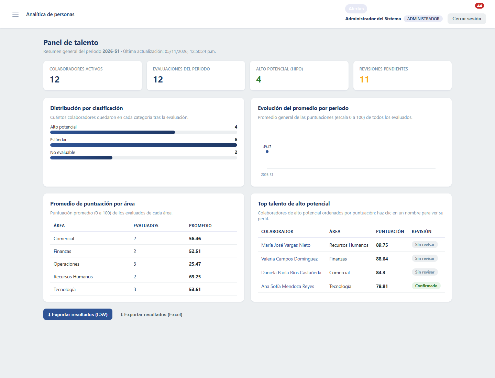
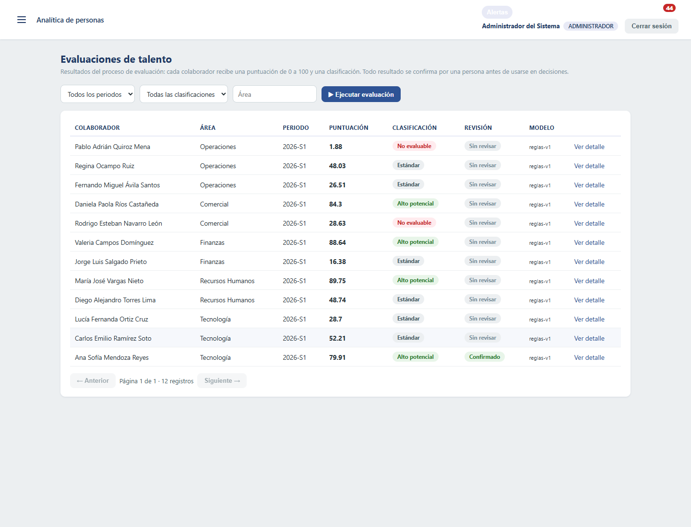
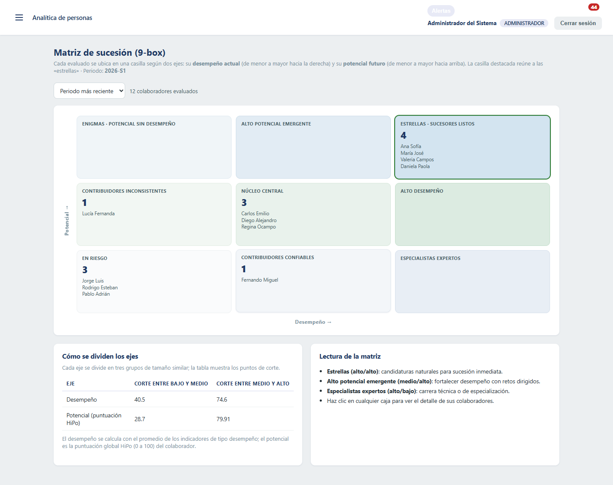
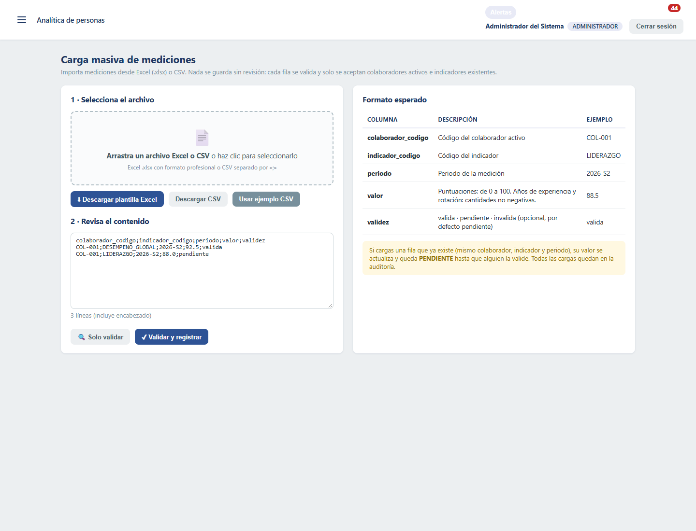

<p align="center">
  
</p>

# Sistema de Identificación de Talento de Alto Potencial

Proyecto de desarrollo para **PluriOne S.A. de C.V. — Develop Talent & Technology**.
Sistema que identifica colaboradores con alto potencial mediante el análisis de desempeño,
competencias, capacitación, experiencia, objetivos y métricas organizacionales, con modelos
analíticos, IA asistida (Azure OpenAI) y revisión humana obligatoria.

La versión de entrega está en la rama `master`.

## Arquitectura

- **Servidor**: Python + FastAPI (capas: rutas → servicios → modelos ORM con SQLAlchemy 2.x).
- **Interfaz web**: React 18 + Vite (SPA con HashRouter).
- **Base de datos**: PostgreSQL en la implementación (SQLite en desarrollo local).
- **IA**: Azure OpenAI Service para explicaciones y consultas asistidas, con degradación
  elegante a un modo local determinista cuando no hay credenciales.
- **Despliegue y automatización**: Docker Compose, GitHub Actions.

## Módulos del sistema

| Módulo | Descripción | Requerimientos |
|---|---|---|
| Autenticación y RBAC | JWT + roles (ADMINISTRADOR, GESTOR_TALENTO, EVALUADOR, CONSULTA) | RF-01, RF-02 |
| Colaboradores | CRUD, perfil consolidado, histórico y observaciones | RF-03, RF-10, RF-11, RF-17, RF-19 |
| Indicadores y mediciones | Catálogo, carga individual/bulk, validación de calidad | RF-04, RN-01, RN-02 |
| **Carga masiva CSV** | Importación de mediciones con validación previa por fila y plantilla descargable | Alcance «carga y validación de datos», RN-01 |
| Evaluaciones HiPo | Pipeline completo con variables derivadas, puntuación y clasificación | RF-05..RF-09, RN-03..RN-05 |
| Revisión humana | Confirmar/marcar pendiente con comentario | RF-18, RN-06 |
| Reportes | Dashboard, exportación CSV y Excel, histórico por periodo | RF-12, RF-13, RF-14 |
| **Matriz 9-box** | Clasificación desempeño × potencial con terciles de la población (sucesión) | Objetivo «sucesión», RF-12 |
| **Comparador** | Comparación de 2-6 colaboradores con radar de indicadores normalizados | RF-12 «comparaciones» |
| **Planes de desarrollo** | Planes de sucesión/liderazgo con acciones, avance automático y riesgo | Objetivo «liderazgo, desarrollo y sucesión» |
| **Centro de alertas** | Campana con pendientes: revisiones, validaciones, planes en riesgo | RN-01, RN-06, RF-15 |
| Configuración | Pruebas (indicadores) por área y versiones de criterios, pesos y umbrales | RF-16, RN-03 |
| Auditoría | Registro persistente de quién, cuándo y sobre qué | RF-15, RNF-04, RN-08 |
| IA asistida | Consultas y explicaciones con contexto autorizado | RF-07, RF-08 |

## Capturas para la demostración

Vistas del sistema con datos de demostración. Haz clic en una imagen para verla en
tamaño completo.

<table>
  <tr>
    <th>Panel de talento</th>
    <th>Evaluaciones</th>
  </tr>
  <tr>
    <td><a href="docs/capturas/panel.png"></a></td>
    <td><a href="docs/capturas/evaluaciones.png"></a></td>
  </tr>
  <tr>
    <th>Matriz de sucesión 9-box</th>
    <th>Carga de mediciones CSV</th>
  </tr>
  <tr>
    <td><a href="docs/capturas/matriz-9box.png"></a></td>
    <td><a href="docs/capturas/carga-csv.png"></a></td>
  </tr>
</table>

## Documentación del proyecto

La documentación complementaria está en la carpeta `docs/`:

- `docs/como-funciona.md`: **guía completa de cómo funciona cada parte del código
  y del proyecto** (capas, modelos, servicios, routers, páginas, pipeline,
  infraestructura y reglas de negocio).
- `docs/prd.md`: PRD del producto (requisitos, historias de usuario, métricas y
  trazabilidad RF → implementación).
- `docs/mvp.md`: qué cubre el MVP y qué quedó para el producto completo.
- `docs/arquitectura.md`: responsabilidades de cada capa y flujo principal.
- `docs/manual-usuario.md`: manual de uso del sistema para el público general.
- `docs/guia-desarrollo.md`: instalación, validaciones y convenciones de trabajo.

La raíz contiene únicamente los archivos de entrada del proyecto: configuración de
Docker, variables de entorno de ejemplo, documentación general y automatización CI.

## Estructura

```
proyecto/
├── backend/
│   ├── app/
│   │   ├── core/         # configuración, seguridad (JWT/PBKDF2), dependencias RBAC
│   │   ├── db/           # motor, sesión, semilla de datos y migraciones ligeras
│   │   ├── models/       # entidades (usuario, colaborador, indicador, evaluación, plan…)
│   │   ├── schemas/      # contratos Pydantic de la API
│   │   ├── services/     # lógica de negocio (flujo HiPo, IA, reportes, planes…)
│   │   ├── routers/      # endpoints HTTP por módulo
│   │   └── main.py       # aplicación FastAPI
│   ├── tests/            # pytest (45 pruebas)
│   └── requirements.txt
├── frontend/
│   └── src/              # React (panel, colaboradores, evaluaciones, matriz 9-box,
│                         #   comparador, carga CSV, planes, alertas…)
├── docker-compose.yml    # PostgreSQL + servidor + interfaz web
└── .github/workflows/ci.yml
```

## Puesta en marcha (desarrollo)

Para iniciar el sistema en desarrollo, elige una de las opciones de base de datos
siguientes. La opción SQLite no requiere Docker ni una instalación de PostgreSQL.

## Base de datos

### Opción A: SQLite local

Es la opción más sencilla para trabajar en la computadora. No requiere instalar
PostgreSQL: si no existe un archivo `.env`, el backend usa `talento.db` y crea las
tablas y los datos de demostración al iniciar.

```powershell
cd backend
python -m venv venv
venv\Scripts\python -m pip install -r requirements.txt
venv\Scripts\python -m uvicorn app.main:app --reload --port 8000
```

Comprueba la conexión en http://localhost:8000/api/health.

### Opción B: PostgreSQL con Docker

Primero abre Docker Desktop y espera a que indique que el motor está funcionando.
Después, desde la raíz del proyecto, ejecuta:

```powershell
docker compose up -d db backend
docker compose ps
```

El servicio `db` usa PostgreSQL en el puerto `5432` y el backend se conecta mediante
la variable `DATABASE_URL` definida en `docker-compose.yml`. Las tablas se crean al
arrancar el backend. Para levantar también la interfaz web:

```powershell
docker compose up -d frontend
```

El script PostgreSQL con el esquema completo, sin datos, está en
`backend/schema.sql`. Para crear la estructura manualmente, ejecútalo conectado a
una base de datos vacía con `psql -U talento -d nombre_base -f backend/schema.sql`.

Si quieres una base **lista para demostrar** (estructura y datos de prueba:
usuarios, roles, 12 colaboradores, 257 mediciones, planes y la evaluación del
periodo 2026-S1 ya ejecutada), usa `db/base-de-datos.sql`:

```powershell
psql -U talento -d nombre_base -f db/base-de-datos.sql
```

Al arrancar después el backend, la semilla automática detecta que la base ya
tiene datos y no vuelve a sembrar.

La API queda disponible en http://localhost:8000/api/health y la interfaz en
http://localhost:8081. Como la aplicación usa rutas con hash, abre
`http://localhost:8081/#/` y no `/dashboard/`. Para detener los servicios sin borrar los datos:

```powershell
docker compose down
```

### Interfaz web

```powershell
cd frontend
npm ci
npm run dev      # abre el navegador; usa la URL que imprime Vite (proxy /api -> localhost:8000)
```

En VS Code también puedes iniciar la aplicación completa con **Run and Debug → Backend FastAPI** (F5):
se inicia Vite, se abre el login en el navegador y después arranca el backend.

### Producción (Docker Compose)

```powershell
docker compose up --build
# Interfaz web: http://localhost:8081 · API: http://localhost:8000/docs · PostgreSQL: 5432
```

Configura los secretos copiando `.env.example` a `.env` (SECRET_KEY, credenciales
Azure OpenAI, contraseña del admin) — nunca versiones el `.env`.

## Usuarios de demostración

| Correo | Contraseña | Rol |
|---|---|---|
| admin@develop.com.mx | Admin123! | ADMINISTRADOR |
| gestor@develop.com.mx | Gestor123! | GESTOR_TALENTO |
| evaluador@develop.com.mx | Evaluador123! | EVALUADOR |
| consulta@develop.com.mx | Consulta123! | CONSULTA |

## Flujo de evaluación (RN del documento de arquitectura)

1. **Validación de datos**: solo mediciones con validez `VALIDA` participan (RN-01).
2. **Variables derivadas**: normalización min-max por indicador dentro de la población
   del periodo, respetando la dirección del indicador (RF-05).
3. **Puntuación**: promedio ponderado según los pesos de la configuración activa (RF-06/07).
4. **Clasificación por umbral configurable**: ≥ umbral HiPo → *Alto potencial*;
   ≥ umbral × banda → *En desarrollo*; resto → *Estándar* (RN-03).
5. **Factores y explicación**: contribuciones por indicador + resumen IA (RF-08/09).
6. **Revisión humana**: confirmar o marcar pendiente (RF-18, RN-06).
7. **Histórico inmutable**: cada ejecución se conserva por periodo (RN-05, RF-17).
8. **Auditoría**: todo queda registrado con usuario, fecha y recurso (RN-08, RF-15).

Si la cobertura de datos válidos es menor al mínimo configurado, la evaluación se marca
**incompleta / no evaluable** y no se presenta como equivalente a una completa (RN-02).

## Funcionalidades adicionales

### Planes de desarrollo y sucesión

Para apoyar los procesos de liderazgo, desarrollo y sucesión (objetivo del negocio):

- Cada plan pertenece a un colaborador, tiene foco (liderazgo/especialista/desarrollo),
  horizonte temporal, responsable y una lista de **acciones** con fecha límite.
- El **avance se recalcula automáticamente** al marcar acciones: al llegar a 100% el plan
  se cierra como completado; si se desmarca una acción, el plan se reabre.
- Un plan abierto con acciones vencidas o fecha fin superada se marca **en riesgo** y
  alimenta el centro de alertas.
- Endpoints: `/api/planes` (CRUD + estadísticas + acciones) y
  `/api/colaboradores/{id}/planes`. Permisos: `planes.consultar` / `planes.gestionar`.

### Matriz de sucesión 9-box

`GET /api/reportes/matriz-9box?periodo=…` clasifica a los evaluados en 9 cuadrantes
(desempeño × potencial) usando **terciles de la población**: desempeño = promedio de
factores tipo desempeño; potencial = puntuación global HiPo. La interfaz muestra la
cuadrícula interactiva y el detalle por cuadrante.

### Comparador de colaboradores

`GET /api/reportes/comparar?ids=1,2,3&periodo=…` devuelve los indicadores de 2-6
colaboradores con sus mediciones **válidas** y su normalización min-max 0-100 entre
comparados. La interfaz lo presenta como **radar SVG** + tabla detalle por indicador.

### Carga masiva de mediciones (Excel y CSV)

- `GET /api/indicadores/plantilla-xlsx` descarga una plantilla Excel formateada, con
  pestañas de instrucciones y mediciones.
- `GET /api/indicadores/plantilla-csv` descarga la plantilla CSV compatible.
- `POST /api/indicadores/carga-xlsx` acepta la pestaña `Mediciones` de un archivo `.xlsx`;
  `POST /api/indicadores/carga-csv` acepta contenido CSV separado por `;`.
- Ambos formatos admiten `validar_solo`: validan fila por fila (colaborador activo,
  indicador existente, valor numérico y validez) y devuelven un **reporte de rechazos
  con motivo y línea** antes de registrar.
- Recargar una combinación colaborador+indicador+periodo hace *upsert* y regresa la
  medición a PENDIENTE para revalidación (RN-01). La operación queda en auditoría.

### Centro de alertas

`GET /api/reportes/alertas` resume los pendientes operativos del periodo más reciente:
resultados sin revisión humana (RN-06), mediciones pendientes/inválidas (RN-01), planes
en riesgo o vencidos y resultados sin explicación (RF-09). Se muestra en la **campana**
de la barra superior (se actualiza cada 2 minutos).

## Pruebas

La suite de backend contiene 45 pruebas pytest. Consulta la [guía de pruebas](docs/pruebas.md), que también documenta `npm test` para la interfaz.

```powershell
cd backend
venv\Scripts\python -m pytest tests -q
```

Verificación end-to-end de todos los módulos contra un servidor real (levanta
uvicorn con una base de datos temporal y ejercita los 11 módulos):

```powershell
cd backend
venv\Scripts\python verificar_modulos_e2e.py
```

Verificación del sistema desplegado con Docker Compose (comprueba la cadena
completa nginx → backend → PostgreSQL en `http://localhost:8081`):

```powershell
cd backend
venv\Scripts\python verificar_vivo.py
```

Para validar el proyecto completo desde la raíz:

```powershell
docker compose config
cd frontend
npm ci
npm run build
cd ..\backend
python -m pytest tests -q
```

Los archivos generados, bases de datos locales, entornos virtuales y logs quedan
fuera del control de versiones mediante `.gitignore`.

## Uso de IA

El proyecto fue diseñado y desarrollado principalmente por mí, Carlos. Definí sus
requerimientos, la organización de sus módulos y las decisiones de implementación;
también integré y revisé el código, la documentación y las pruebas del sistema.

Utilicé GitHub Copilot en VS Code como apoyo complementario para resolver dudas
técnicas, identificar posibles errores y revisar algunos detalles de código y
documentación. Las sugerencias de la IA no se incorporaron automáticamente: yo evalué
cuáles eran pertinentes, realicé los ajustes necesarios y mantuve la responsabilidad
por las decisiones técnicas y la validación final del proyecto.

## Cobertura de requerimientos

- RF-01..RF-19 y RNF-01..RNF-14 implementados en el servidor y la interfaz web según los documentos
  de requerimientos, propuesta técnica y arquitectura.
- RF-07 (Azure Machine Learning): el diseño versiona el modelo (`MODELO_VERSION`) y
  aísla la puntuación en `evaluacion_service`, listo para sustituir/complementar la
  puntuación por reglas con un endpoint de Azure ML.
- RNF-10: CI con GitHub Actions (pruebas del servidor + compilación de la interfaz web).
- Objetivos de negocio «liderazgo, desarrollo y sucesión»: cubiertos con los **planes de
  desarrollo**, la **matriz 9-box** y el comparador; el alcance «carga y validación de
  datos» se refuerza con la **carga masiva CSV** con reporte de validación.
